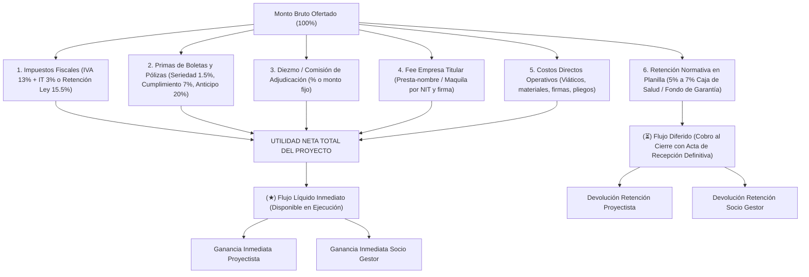

# CALC Deals — Calculadora de Negociación y Reparto de Proyectos

Herramienta especializada de ingeniería financiera para **licitaciones públicas (SICOES), contratos corporativos y consultoría técnica**. Permite simular y transparentar de antemano todas las deducciones invisibles, cargas fiscales, primas de boletas bancarias, diezmos, retenciones y fees de empresa titular ("presta-nombre"), para determinar la **ganancia líquida real del proyectista y los socios** antes de firmar cualquier propuesta.

---

## 💡 Modelo Financiero y Cascada de Deducciones



---

## 🏗️ Arquitectura del Monorepo

* **`packages/shared` (`@calc/shared`)**: Motor matemático puro (`calculateDeal`) y tipos de dominio fuertemente tipados. Desacoplado de frameworks.
* **`apps/web`**: Interfaz de usuario interactiva y reactiva construida en **Next.js 16 (App Router)** y React 19, con controles deslizantes, presets de licitación, cascada porcentual visual, tabla de flujo y simulador inverso ("¿Cuánto debo cotizar para ganar X?").
* **`apps/api`**: Backend en **NestJS 11** con **Prisma ORM 6** (PostgreSQL) para persistencia y auditoría de sesiones de negociación.

---

## 🚀 Comandos Rápidos

```bash
# Instalar dependencias
pnpm install

# Compilar todo el monorepo
pnpm build

# Ejecutar pruebas unitarias
pnpm --filter api test

# Ejecutar linter
pnpm lint

# Levantar frontend en desarrollo
pnpm dev:web

# Levantar backend API en desarrollo
pnpm dev:api
```
