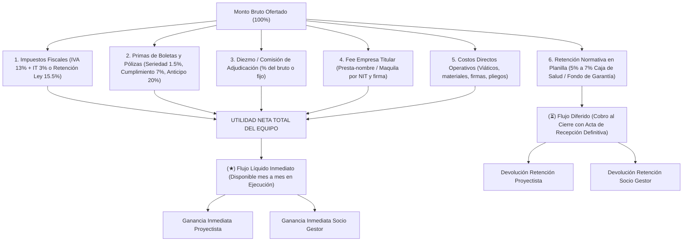

# CALC Deals — Calculadora de Negociación y Reparto de Proyectos

> **Herramienta de ingeniería financiera y negociación pre-firma para licitaciones públicas (SICOES), contratos corporativos, subcontratos y consultorías.**  
> Permite evaluar con exactitud quirúrgica todas las deducciones, peajes impositivos, primas de boletas bancarias, retenciones de ley, diezmos y comisiones de empresa prestanombre antes de firmar cualquier contrato.

---

## 🎯 ¿Qué problema resuelve?

En contratos y licitaciones, el **monto que figura en el papel nunca es el dinero real que entra a la mesa**. Si no se calculan de antemano los costos financieros de las boletas, las retenciones de planilla (caja de salud/fondo de garantía), las comisiones de adjudicación y el fee de quien presta el NIT/firma, los socios terminan repartiendo dinero ficticio o trabajando a pérdida.

**CALC Deals** transparenta la realidad de la mesa antes de firmar:
* ¿Cuánto dinero líquido real entra mes a mes durante la ejecución?
* ¿Cuánto capital queda congelado en retenciones hasta el acta de recepción definitiva?
* ¿Cuánto se llevan el Estado, las aseguradoras, los intermediarios y la empresa titular?
* ¿Cuál es la ganancia neta real y el margen porcentual que se lleva el proyectista al bolsillo?

---

## 💡 Modelo Financiero y Cascada de Deducciones



---

## ⚙️ Variables y Palancas del Motor de Cálculo

### 1. Régimen Tributario (Fijo por Ley con Opción de Activación)
* **Con Factura Oficial (16% nominal):** 13% IVA + 3% IT, con opción de amortiguar mediante porcentaje de crédito fiscal de compras.
* **Retención de Ley (15.5%):** 12.5% IUE + 3% IT aplicable a servicios sin factura formal.
* **Sin Factura / En Mano (0%):** Conmutador táctil para habilitar o deshabilitar deducciones tributarias en 1 toque.
* **Tasa Personalizada:** Para regímenes especiales o alícuotas negociadas.

### 2. Boletas Bancarias y Pólizas de Caución (A Fondo Perdido)
* **Boleta de Seriedad de Propuesta:** 1.5% afianzado del valor referencial + prima de emisión bancaria o de aseguradora.
* **Boleta de Cumplimiento de Contrato:** 7% normativo afianzado + costo de prima/comisión.
* **Boleta de Anticipo:** Garantía por el 100% del anticipo recibido (típicamente 20% del contrato).

### 3. Retención Normativa en Planilla (5% a 7%)
* Deducción por planilla (Caja de salud o fondo de garantía por pliego).
* **Switch de Recuperabilidad:**
  * *Recuperable al cierre:* Fondo de garantía que se reembolsa con la Recepción Definitiva (flujo diferido).
  * *Gasto a fondo perdido:* Aporte social a caja de salud no devuelto.

### 4. Fricciones Comerciales y Presta-Nombre
* **Diezmo / Comisión de Adjudicación:** % sobre el monto bruto o monto fijo pactado con el contacto.
* **Empresa Titular (Presta-Nombre / Maquila):** % acordado por poner el NIT, RUPE, cuenta bancaria y firma, con opción de definir si la empresa asume o no el costo de las boletas.

### 5. Costos Directos de Obra
* Gestión dinámica de gastos operativos: viáticos, combustible, impresiones de carpetas técnicas, subcontratos e insumos.

### 6. Reparto y Simulador Inverso
* **División Proyectista vs Gestor:** Porcentaje de reparto de la utilidad neta + fondo de reserva para imprevistos.
* **Simulador Inverso:** *"Quiero que me queden X Bs limpios en mano"* $\rightarrow$ Calcula al instante el monto mínimo que debes cotizarle al cliente.

---

## 📱 Optimización Mobile-First y Empaquetado APK

La interfaz está diseñada pensando en su uso primario en el **teléfono móvil durante mesas de negociación** y para ser empaquetada como **aplicación móvil nativa (APK)**:

* **Cero Desbordamiento Horizontal:** Contenedores fluidos con `min-width: 0` y `clamp()` para adaptarse a pantallas desde 360px de ancho sin recortes de texto.
* **Navegación Táctil por Pestañas:**
  * `🎛️ Variables`: La mesa para ajustar el monto del contrato, impuestos, boletas, diezmos y costos.
  * `📊 Resultados`: Tarjetas de ganancia neta, gráfico de absorción de capital y libro mayor de liquidación.
  * `🎯 Meta`: Simulador inverso en tiempo real.
* **Barra Flotante Persistente:** En pantallas móviles, una barra inferior fija muestra permanentemente tu **Ganancia Neta** y permite alternar vistas con un toque.
* **Ergonomía Táctil:** Objetivos de toque de 44px+ y tipografía a 16px para evitar el zoom automático en Android y iOS.

---

## 🐳 Despliegue Nativo con Docker

El proyecto incluye orquestación nativa mediante Docker Compose:

| Servicio | Contenedor | Puerto Host | Descripción |
| :--- | :--- | :---: | :--- |
| **`calc_web`** | `calc-deals-web` | **`3000`** | Next.js 16 standalone (**imagen ultra ligera de solo 203 MB**). |
| **`calc_api`** | `calc-deals-api` | **`3001`** | NestJS 11 con Node 22, Prisma ORM 6 y migraciones automáticas. |
| **`calc_db`** | `calc-deals-db` | **`5434`** | PostgreSQL 16 Alpine con volumen persistente (`calc_deals_pgdata`). |

*(Nota: La base de datos corre en el puerto `5434` del host para no interferir con otros servicios locales).*

### Comandos de Docker

```bash
# Levantar todo el stack en segundo plano
docker compose up -d

# Ver estado de los contenedores
docker compose ps

# Ver logs en vivo
docker compose logs -f

# Reconstruir imágenes tras cambios de código
docker compose up -d --build

# Detener los servicios
docker compose down
```

---

## 🏗️ Arquitectura del Monorepo

* **`packages/shared` (`@calc/shared`)**: Motor matemático puro (`calculateDeal`) y tipos de dominio TypeScript (`DealCalculationInput`, `DealCalculationResult`). 100% desacoplado de frameworks UI o backend.
* **`apps/web`**: Aplicación frontend construida en **Next.js 16 (App Router)**, React 19 y CSS Modules optimizados para móvil.
* **`apps/api`**: Backend en **NestJS 11** con **Prisma ORM 6** (PostgreSQL) para persistencia y auditoría de sesiones de negociación.

---

## 🛠️ Comandos de Desarrollo Local (PNPM Workspaces)

```bash
# Instalar dependencias del monorepo
pnpm install

# Compilar todos los paquetes y aplicaciones
pnpm build

# Ejecutar suite de pruebas unitarias
pnpm --filter api test

# Ejecutar análisis de linter (ESLint)
pnpm lint

# Levantar frontend web en modo desarrollo
pnpm dev:web

# Levantar backend API en modo desarrollo
pnpm dev:api
```
